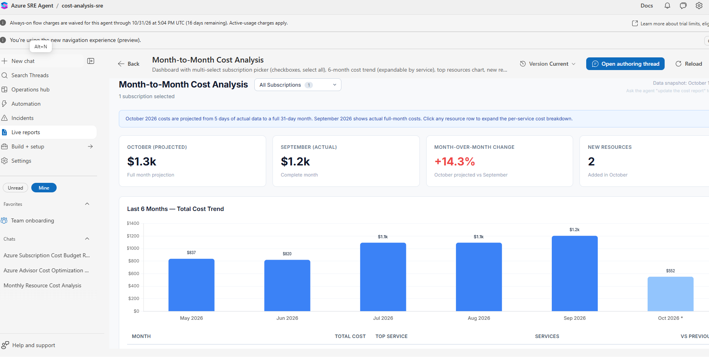
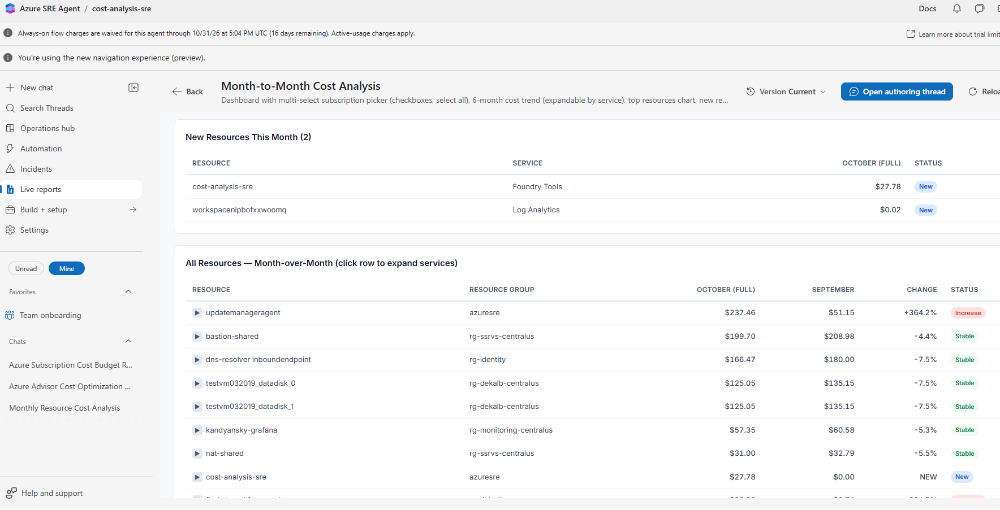
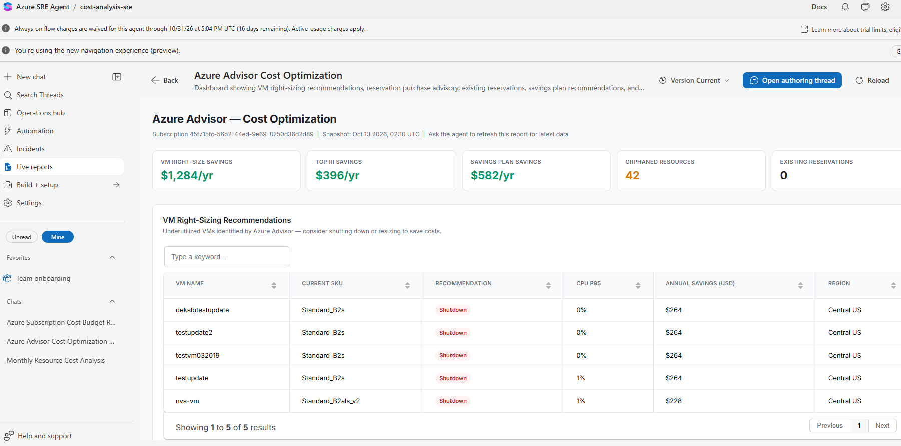
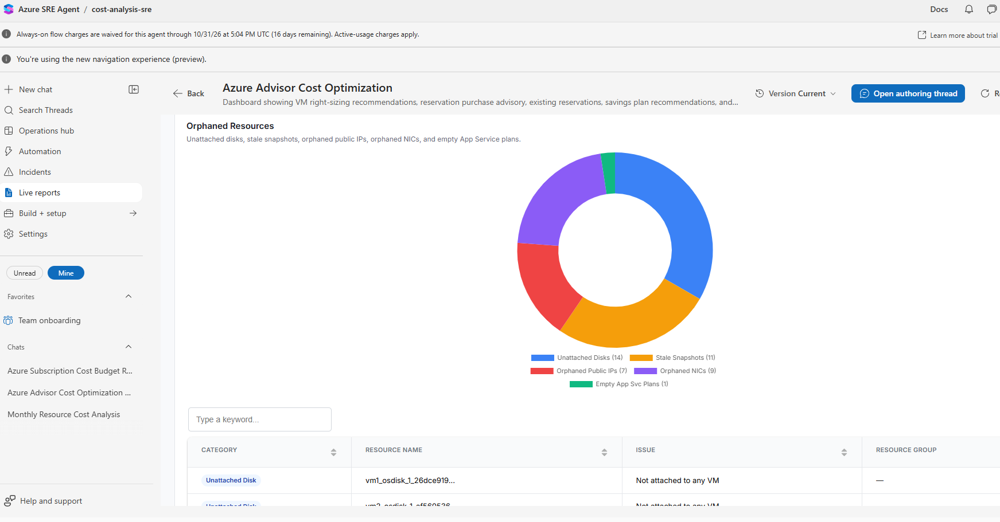

# Conversational Cost Analytics Agent

An Azure SRE Agent solution for investigating Azure spend in natural language, comparing month-over-month costs, identifying resource-level cost drivers, and presenting findings in an interactive Live Report.

The repository includes an importable dashboard template, reusable agent skills, setup prompts, screenshots, and the full [use-case description](Azure-SRE-Agent-Cost-Analytics-Use-Case.md).

## Capabilities

- Discover accessible Azure subscriptions.
- Compare current and previous-month costs by subscription and resource.
- Show a six-month cost trend with service-level drill-down.
- Identify new resources and their contribution to current spend.
- Rank the resources driving increases and decreases.
- Surface Azure Advisor optimization and orphaned-resource findings.
- Generate and periodically refresh an Azure SRE Agent Live Report.

## Dashboard Preview

### Month-to-Month Overview

Summary KPIs, projected current-month spend, prior-month actuals, and a six-month trend.



### Resource-Level Changes

New-resource detection and expandable resource-level month-over-month comparisons.



### Azure Advisor Cost Optimization

Rightsizing and savings opportunities derived from Azure Advisor data.



### Orphaned Resources

Inventory of unattached disks, stale snapshots, orphaned public IPs and NICs, and empty App Service plans.



## Repository Structure

```text
ConversationalCostAnalyticsAgent/
|-- README.md
|-- Azure-SRE-Agent-Cost-Analytics-Use-Case.md
|-- Dashboard/
|   |-- live-report-template.html
|   |-- bootstrap-prompt.md
|   `-- README.md
|-- Skills/
|   |-- month-over-monthSKILL.md
|   `-- live-report-query-reference-SKILL.md
`-- Screenshots/
    |-- month-to-month-overview.png
    |-- month-to-month-resources.png
    |-- advisor-cost-optimization.png
    `-- advisor-orphaned-resources.png
```

## Import the Dashboard

The [Live Report template](Dashboard/live-report-template.html) is a reusable HTML dashboard with a subscription picker, KPI cards, a six-month trend, top-resource comparisons, new-resource detection, and expandable cost details.

1. Add both files from [Skills](Skills/) to the agent's knowledge or skills collection.
2. Assign the agent identity `Cost Management Reader` and `Reader` on every subscription in scope.
3. Open [Dashboard/bootstrap-prompt.md](Dashboard/bootstrap-prompt.md) and submit the first-run prompt to the Azure SRE Agent.
4. Provide [Dashboard/live-report-template.html](Dashboard/live-report-template.html) when prompted to create or import the Live Report.
5. Review the generated report and optionally use the scheduled-refresh prompt from the same bootstrap file.

The template contains no live customer data. The bootstrap workflow discovers subscriptions, queries Azure Cost Management, populates the template, and saves it as a Live Report. See the [dashboard deployment guide](Dashboard/README.md) for query flow, customization, refresh scheduling, and troubleshooting.

## Skills

### Month-over-Month Analysis

[month-over-monthSKILL.md](Skills/month-over-monthSKILL.md) defines the read-only analytical workflow. It explains how to compare subscription totals, calculate resource contribution, identify newly billed resources, enrich results with Azure Resource Graph, and handle partial-month data safely.

### Live Report Query Reference

[live-report-query-reference-SKILL.md](Skills/live-report-query-reference-SKILL.md) contains the SRE Agent-specific Azure CLI and Cost Management query patterns used to populate the dashboard. It also documents response shapes, aggregation rules, tool mappings, and unsupported approaches to avoid.

## Required Access

| Role | Purpose |
|---|---|
| `Cost Management Reader` | Read subscription cost and usage data. |
| `Reader` | Discover subscriptions and enrich resources through Azure Resource Graph. |

Keep the solution read-only by default. Validate recommendations and require explicit approval before resizing resources, deleting orphaned assets, or purchasing reservations or savings plans.

## Important Data Notes

- Current-month cost is partial until month-end; projected values must be labeled.
- Azure Cost Management provides billing data. Azure Resource Graph does not contain cost.
- Cost data can lag behind current usage.
- Resolve Cost Management response columns by name because their order is not guaranteed.
- Treat optimization savings as estimates, not guaranteed realized savings.

## Example Prompts

> Which subscriptions and resources explain the largest cost increases compared with last month?

> Show newly billed resources separately from resources created this month.

> Build the six-month cost dashboard and rank the top resource-level changes.

> Show Azure Advisor savings opportunities and orphaned resources that require owner review.
